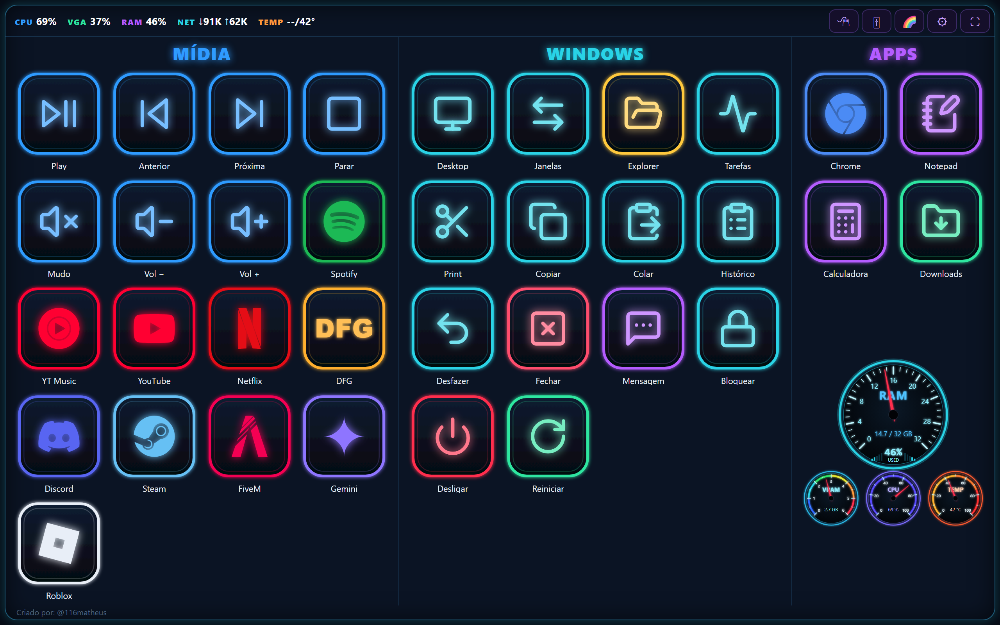
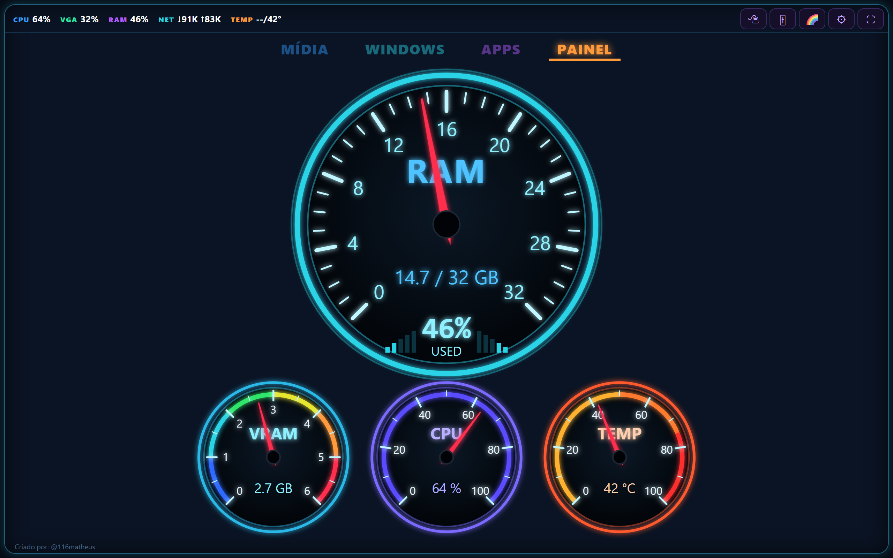
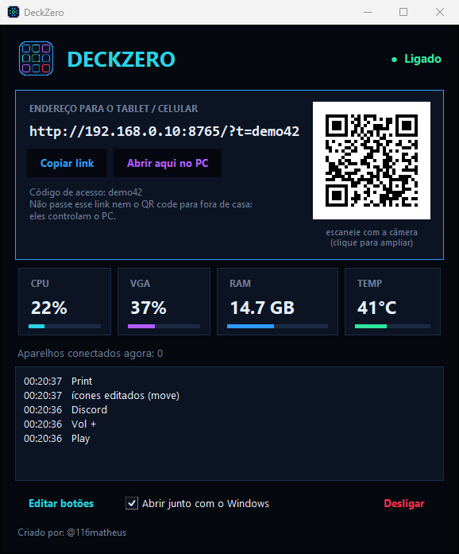
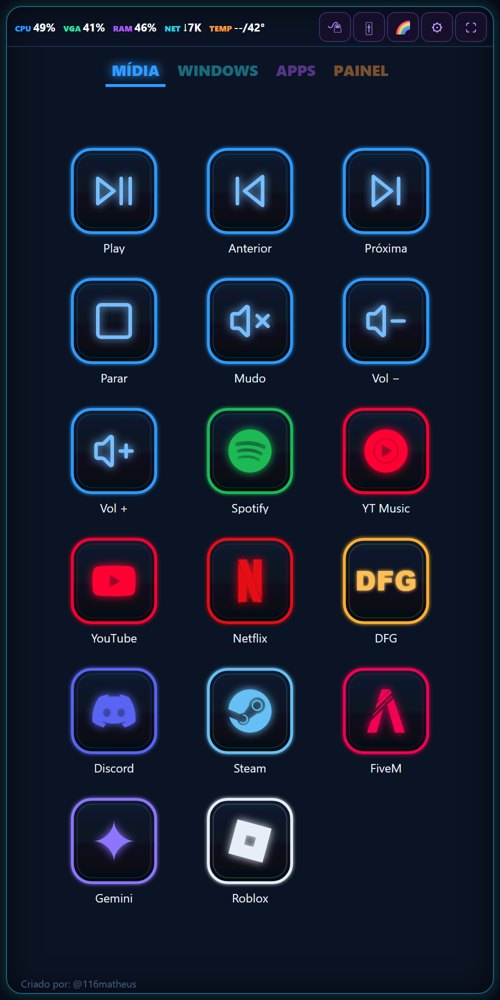
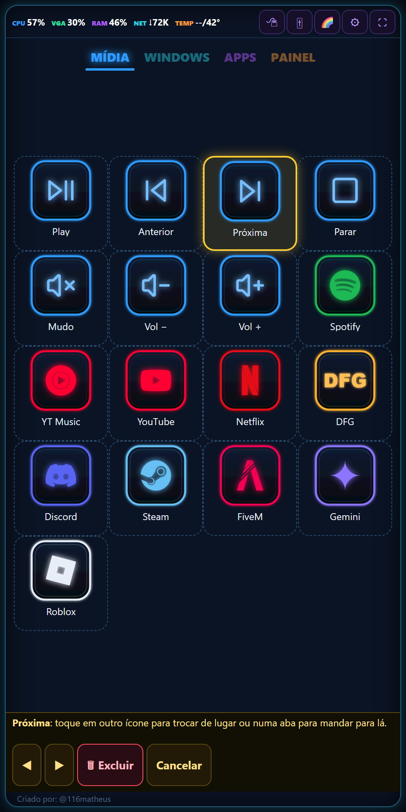
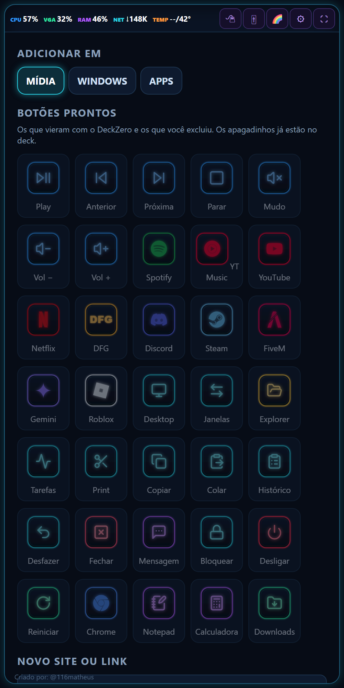
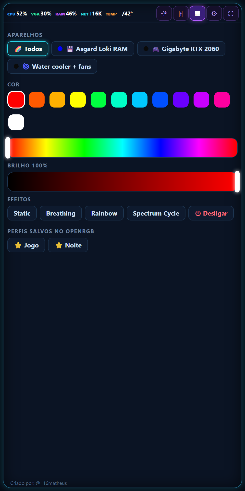

# DeckZero

**Transforma um celular ou tablet num painel de atalhos para o PC, no estilo de uma "stream deck", sem comprar nada.**

Serve até aquele tablet velho parado na gaveta. Ele fica do lado do teclado mostrando botões grandes: você toca e o PC obedece. Pausa a música, abre o Discord, tira print, ajusta o volume de cada programa, troca a cor do RGB e mostra ao vivo o uso de CPU, placa de vídeo, RAM e temperatura.

Criado por: @116matheus

## O que ele faz

**Botões para tudo**
- Mídia: play/pause, anterior, próxima, volume e mudo
- Abre sites, apps (Spotify, Discord, Steam...) e programas do PC
- Atalhos do Windows: área de trabalho, trocar janela, print, copiar/colar, desfazer, fechar janela, bloquear
- Desligar e reiniciar o PC (pedem um segundo toque para confirmar)

**Painel do PC ao vivo**
- Medidores de RAM, memória da placa de vídeo, CPU e temperatura
- As escalas se ajustam sozinhas ao PC: 8 GB ou 64 GB de RAM, placa de 4 GB ou 24 GB

**Mais ferramentas**
- Mixer de volume separado por programa (o jogo baixo e o Discord alto, por exemplo)
- Touchpad para controlar o mouse, e espelho da tela do PC
- Histórico de tudo que você copiou no PC: toque para colar de novo
- Controle de RGB: cor, brilho, efeitos e perfis da RAM, placa de vídeo, fans e o que mais o [OpenRGB](https://openrgb.org) reconhecer

**Do seu jeito**
- Edite os ícones direto no celular: mover, trocar de seção, excluir e adicionar
- Crie botões novos de sites ou de atalhos de teclado
- Gire a tela, escolha ícones grandes ou tudo numa tela só, deixe a tela sempre ligada
- Conecta lendo um QR code, e acha o PC sozinho se o IP mudar

**No PC**
- Janela própria, com o QR code e o que está sendo apertado
- Ao minimizar, fica só no ícone perto do relógio
- Opção de abrir junto com o Windows

## Prints

| Painel ao vivo | Janela do PC |
|---|---|
|  |  |

| Celular | Editando os ícones | Adicionar botões | RGB |
|---|---|---|---|
|  |  |  |  |

## Como instalar

Baixe os dois arquivos na página de [Releases](../../releases/latest).

**No PC (Windows 10/11)**

1. Baixe o `DeckZero.exe` e coloque numa pasta só dele (ex.: `Documentos\DeckZero`).
2. Abra. Se aparecer "O Windows protegeu o computador", clique em **Mais informações → Executar assim mesmo** (o programa não tem assinatura paga).
3. A janela mostra um endereço e um QR code.

**No celular ou tablet (Android 4.1 ou mais novo)**

1. Baixe e instale o `DeckZero.apk` (o Android vai pedir para permitir instalar de fontes desconhecidas).
2. Abra o app e toque em **LER QR CODE DO PC**, apontando para o QR code da janela do PC.

Também funciona sem o app: aponte a câmera do celular (ou do iPhone) para o QR code e o deck abre no navegador.

O PC e o aparelho precisam estar no **mesmo Wi-Fi**.

## Segurança

O QR code e o endereço levam o **código de acesso** do seu PC. Quem tiver esse código, na mesma rede, consegue controlar o PC. Não mostre nem mande para ninguém que não deveria. Cada PC gera o seu próprio código na primeira vez que o DeckZero abre.

## RGB

Para controlar as luzes RGB, instale o [OpenRGB](https://openrgb.org) e ligue o **SDK Server** nele. O DeckZero controla tudo que o OpenRGB reconhecer.
